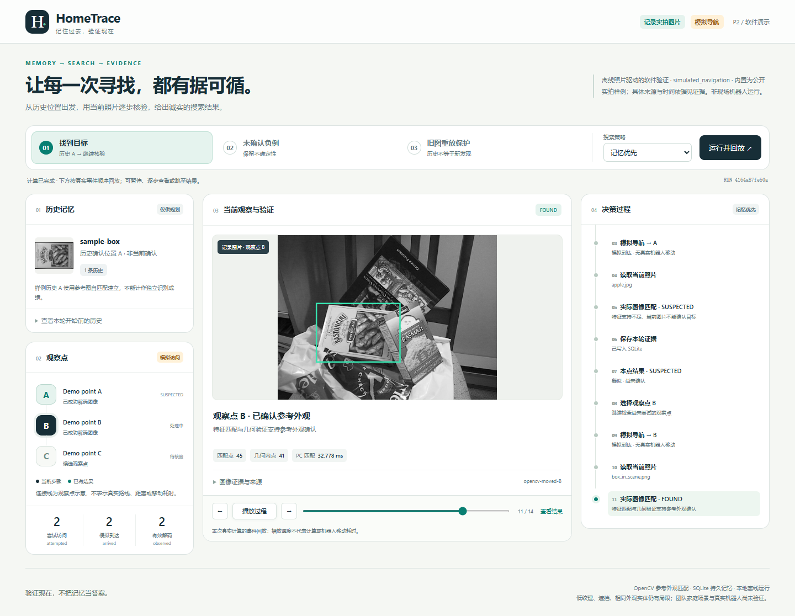

# HomeTrace — 家庭时空记忆与主动寻物机器人

> Huawei Embedded AI Challenge 2026 / 开放创新赛道

**项目状态（2026-10-27）：** 当前分支增量实现 [Issue #24 家庭记忆工作区](docs/HOUSEHOLD_WORKSPACE.md)，依赖未合并的 [PR #23](https://github.com/Qcx526/HomeTrace/pull/23)。名称登记、主人陈述位置和待确认交互可持久保存；本页尚未接入照片外观登记或自动寻找。[共享冻结模型实验](docs/VISION_R3_SHARED_MEMORY_20261027.md) 仍不足以证明家庭实例识别通过。已有 [真实 LLM Agent](docs/P4_AGENT.md)、经典三场景及历史证据保留；导航始终为模拟，没有真实机器人运行数据。本分支不代表 main 已包含这些增量，也不代表正式参赛包完成。

新增入口：按下方命令启动后打开 [家庭记忆工作区](http://127.0.0.1:8765/household.html)，无需 API Key 或模型训练。默认数据目录为 `artifacts/household/`，可用 `--household-dir` 指定并在重启时复用。同名物品须选择、位置须确认；主人陈述不会变成视觉 FOUND。本轮 HTTP 持久化与回归已验证，浏览器页面实操因工具禁用尚未验证，详见[验收与限制](docs/HOUSEHOLD_WORKSPACE.md)。内部材料目标为 **11 月 2 日结束前完成整理**，与赛事平台截止时间分别核验。

## 一句话产品定义

HomeTrace 让家庭机器人记住物品曾经在哪里，通过历史位置与实时观察，自主搜索被移动的物品，并给出附有观测证据的搜索结果。

## 当前初赛计划（2026-11-04，具体截止时刻待官方提交页面核验）

在不依赖官方底盘的条件下完成可互动的小 Demo：用户指定已注册物品 → 查询历史记忆 → 选择搜索地点 → 在**真实采集**的场景图片中识别 → 找不到时更新判断并重规划 → 输出结果与证据。模拟导航和真实图像观察必须清晰区分。

比赛评分关注创新性、实现完整性与可实用性。优先使用成熟开源视觉方法，产品创新与执行闭环优先于从零发明算法。

## 单命令启动可视化 Demo

真实模型 Agent 是可选模块：安装 `.[agent,dev,vision]`，在本地 `.env` 填写 `HOMETRACE_LLM_API_KEY`，模型及预算统一编辑 `config.yaml`。运行 `python -m hometrace demo --agent --port 8765 --output-dir artifacts/p4-demo` 后打开 `/agent.html`。使用千问AI平台托管的指定模型；无 Key、服务失败明确停止，不能切换为假 Agent。完整命令、实际正负例、工具轨迹与限制见 [P4 Agent](docs/P4_AGENT.md)。以下经典三场景继续独立可用。

Python 3.11+，在仓库根目录安装后启动；界面使用 Python 标准库 HTTP 服务与本地 HTML/JS，无额外 UI 框架或 CDN：

```powershell
python -m venv .venv
.\.venv\Scripts\python.exe -m pip install -e ".[dev,vision]"
.\.venv\Scripts\python.exe -m hometrace demo --port 8765 --output-dir artifacts/p2-demo
```

打开 [本地 Demo](http://127.0.0.1:8765)，依次选择“寻找目标”“未确认负例”“旧图重放保护”，点击“运行并回放”。每次点击都会在独立进程中实际登记和搜索，冻结同一份图片给两种策略使用，并保存独立 SQLite 和报告。随后页面按真实事件回放历史位置、逐步决策、模拟导航、实拍图及匹配框、证据和最终结果；可暂停、单步或下载报告。

P2 留存 [148 项测试通过、0 跳过](docs/evidence/issue-3/pytest.txt)，包含未改动的 54 项 P0 和 68 项 P1；已在全新环境安装 0.3.0 wheel 验证。实际结果为 `moved: FOUND/B`、`missing: SUSPECTED/null`、`replay: UNKNOWN/null`。三组固定顺序与记忆优先对照的步数均打平，不声称取得效率提升。详见 [运行与验收](docs/P2_DEMO.md)、[连续实际录屏 MP4](docs/evidence/issue-3/browser/demo-three-scenarios.mp4) 和 [浏览器逐步检查](docs/evidence/issue-3/browser/browser-checks.json)。



录屏是自动操作浏览器的实际软件运行，非效果动画；播放节奏不代表机器人移动耗时。P3 已完成家庭实拍评估：25 图对 × 3 方法共 75 次评价，无 FOUND，保留未确认与失败原因。自编 Word、PPT 与中文字幕视频见 [交付材料](docs/submission/README.md)，候选包及人工门槛见 [初赛交付准备表](docs/SUBMISSION_READINESS.md)。服务只监听本机 `127.0.0.1`；停止用 `Ctrl+C`。macOS/Linux 可替换解释器路径，但本轮未实测这两个系统。

## P3 材料与本地候选 ZIP

P4 更新：主办方官方 DOCX 已取得，Issue #12 将保留原表结构填写；下述团队自编说明书和旧媒体属于历史补充材料，不能替代官方填报主表。最终材料待实际 Agent/视觉结论通过 PM 审核后同步，旧 ZIP 不作为新版提交。Issue #11 按最终合同使用真实 LLM API，不以离线或 Mock Agent 验收。

2026-10-23 新增四组家庭实拍的正式对照已复现耳机壳参考图中的木纹背景误报。仅在登记时固定物体 ROI 可消除本次空桌面误确认，但仍没有可靠家庭正例；不要将耳机壳加入“家庭已找到”展示。新增 40 项评价与此前 75 项评价分开统计，见 [登记 ROI 实验与运行方法](docs/REGISTRATION_ROI_EVALUATION.md)。公共 OpenCV 三场景保持稳定回归。现有 Word/PPT/视频是 PR #8 历史材料，最新边界以 R1 报告为准；旧 candidate 不包含本次代码，不能作为 R1 提交包。

[实施与命令](docs/P3_DELIVERY.md) · [226 项回归及实际证据](docs/evidence/issue-4/README.md) · [家庭照片实测](docs/TEAM_PHOTO_EVALUATION.md) · [打包工具](docs/SUBMISSION_TOOL.md)

官方初赛 DOCX 已取得，由 Issue #12 独立填写并保持原表结构；团队自编《HomeTrace 作品设计与技术说明书》仅作补充。公开材料不含团队私人照片或真实姓名/手机号；最终身份字段由负责人在本地填写。P4 审查合并后再更新正式媒体及 ZIP，旧包不能冒充当前成果。把实际 DOCX、PPTX、MP4 和报告放入私有材料目录，复制并编辑配置后运行：

```powershell
.\.venv\Scripts\python.exe tools/build_submission.py --config local_data/submission/config.json --check
.\.venv\Scripts\python.exe tools/build_submission.py --config local_data/submission/config.json
```

配置示例为 `examples/submission_config.example.json`。ZIP 输出在 Git 忽略的 `dist_submission/`，成功状态仍是待人工核验的 candidate，不能自动标记官方格式通过或已上传。提交前负责人须打开本届赛事提交页面检查格式、命名、大小、附件与截止时间。

## 运行 P1 真实图片 CLI

需要 Python 3.11 或更高版本。在仓库根目录执行以下 PowerShell 命令；已有 `.venv` 时可跳过创建步骤。`vision` 是可选依赖，安装 OpenCV，无需下载模型权重。

```powershell
python -m venv .venv
.\.venv\Scripts\python.exe -m pip install -e ".[dev,vision]"
.\.venv\Scripts\python.exe -m hometrace register --db artifacts/p1-moved/memory.sqlite3 --object-id sample-box --reference box.png --scene examples/recorded_images/history.json --output-dir artifacts/p1-moved/register
.\.venv\Scripts\python.exe -m hometrace search --db artifacts/p1-moved/memory.sqlite3 --object-id sample-box --scene examples/recorded_images/moved.json --output-dir artifacts/p1-moved/search
```

`register` 与 `search` 是两个独立进程，共用 `--db` 指定的 SQLite 数据库。注册保存参考图路径、SHA256 与历史观测；搜索重新读库，先访问历史点 A，未获确认后继续到 B，对实际图片像素执行 ORB + Hamming + RANSAC 匹配。参考图本身用作注册历史，属于登记检查；不同的 `box_in_scene.png` 才是跨图正例。`FOUND` 表示图片中的平面纹理匹配登记外观，不能区分完全相同包装的多个实体。

负例使用独立数据库，让三张负例照片都实际参与匹配：

```powershell
.\.venv\Scripts\python.exe -m hometrace register --db artifacts/p1-missing/memory.sqlite3 --object-id sample-box --reference box.png --scene examples/recorded_images/history.json --output-dir artifacts/p1-missing/register
.\.venv\Scripts\python.exe -m hometrace search --db artifacts/p1-missing/memory.sqlite3 --object-id sample-box --scene examples/recorded_images/missing.json --output-dir artifacts/p1-missing/search
.\.venv\Scripts\python.exe -m pytest -q
```

macOS / Linux 可将解释器路径替换为 `.venv/bin/python`，用 `python3 -m venv .venv` 创建环境。完整重新演示应换一个新的数据库路径；重复注册同一目标会报错，换 ID 或时间重放已见图片也不会成为新证据。已完成但未确认的搜索可能返回 `UNKNOWN` 或 `SUSPECTED`，进程退出码仍为 `0`，应读取 `report.json` 的 `result_status`。

每个输出目录保存 `report.json` 和 `events.jsonl`；P1 数据库持续保存在 `--db`，不复制为输出快照。五张图片是用户授权使用的 OpenCV 公开实拍样例，原始字节未修改，**不是团队家庭照片或机器人数据**。真实拍摄日期未知；A/B/C 和清单时间是 `demo_sequence` 编排，不是现实搬移实验。报告明确标记 `recorded_image` 与 `simulated_navigation`。详见 [P1 说明与验收](docs/P1_IMPLEMENTATION.md)、[视觉方案](docs/P1_VISION_CHOICE.md)、[图片来源与许可](examples/recorded_images/README.md)。

本轮已在 Windows 10 / Python 3.11.4 的全新虚拟环境安装 wheel 验证：[122 项测试全部通过](docs/evidence/issue-2/pytest.txt)，包含未改动的原有 54 项 P0 测试。实测 [moved](docs/evidence/issue-2/moved/search/report.json) 为 A `SUSPECTED` → B `FOUND`；独立库的 [missing](docs/evidence/issue-2/missing/search/report.json) 最终为 `SUSPECTED`、位置 `null`、确认列表为空。同库 [重放](docs/evidence/issue-2/replay/report.json) 拒绝 A/B 旧证据，最终 `UNKNOWN`，仅 C 产生新的解码观察。

[四张独立评估图片](docs/evidence/issue-2/vision-results.json) 中有 1 张正例、3 张负例：没有误报 `FOUND`，正例未漏报，但 2 张负例为 `SUSPECTED`。登记自匹配不计入正例，重复测时不增加样本数；这是小样本验证，不能推断家庭场景精度或端侧性能。完整命令、环境与源码校验见 [验证记录](docs/evidence/issue-2/validation.json)，复跑方式见 [P1 验收与证据](docs/P1_IMPLEMENTATION.md#验收与证据)。

<a id="运行本阶段-demo"></a>

## 运行 P0 fixture Demo

P0 的 CLI 命令保持不变，运行时仅使用 Python 标准库；测试使用 pytest。以下命令在仓库根目录执行。

Windows PowerShell：

```powershell
python -m venv .venv
.\.venv\Scripts\python.exe -m pip install -e ".[dev]"
.\.venv\Scripts\python.exe -m hometrace --scenario moved --output-dir artifacts/moved
.\.venv\Scripts\python.exe -m hometrace --scenario missing --output-dir artifacts/missing
.\.venv\Scripts\python.exe -m pytest -q
```

macOS / Linux：

```bash
python3 -m venv .venv
.venv/bin/python -m pip install -e ".[dev]"
.venv/bin/python -m hometrace --scenario moved --output-dir artifacts/moved
.venv/bin/python -m hometrace --scenario missing --output-dir artifacts/missing
.venv/bin/python -m pytest -q
```

两个内置 fixture 都使用观察点 A、B、C 与注册目标 `remote-control`：

| 场景 | 测试输入 | 预期行为 |
| --- | --- | --- |
| `moved` | 历史标注在 A；当前 A 未见目标、B 标注目标存在 | 查询历史 → 检查 A → 根据当前未找到的结果重新规划 → 检查 B → 报告 `FOUND` |
| `missing` | 历史标注在 A；当前记录没有可确认的目标，包含遮挡记录 | 检查候选点并保留逐点观测结果 → 最终报告 `UNKNOWN`，不假报 `FOUND` |

**P0 终端中的 Mock navigation 表示模拟运动。** 此处的 `FOUND` 只表示 fixture 标注规则给出确认，不证明现实物品存在；P0 没有加载真实图片，也没有连接摄像头或机器人。P0 观测均标记 `data_source = fixture`，`image_path` 与 `image_hash` 为 `null`。

每次运行会在 `--output-dir` 下生成 `report.json`（最终报告与证据）、`events.jsonl`（逐步结构化事件）、`memory.sqlite3`（本次记忆快照）。每次任务从 fixture 初始化独立的内存数据库，不复用上次运行的知识；再次指定相同输出目录会覆盖这些同名产物。默认场景为 `moved`，默认输出目录为 `artifacts/demo`。

可用 `--object-id remote-control` 指定已注册目标，用 `--fixture <路径>` 加载符合内置格式的自定义测试 fixture；输入要求、代码结构及验收边界见 [P0 实现与验证说明](docs/P0_IMPLEMENTATION.md)。

Issue #1 的历史验证在 Windows / Python 3.11.4 的全新虚拟环境安装 wheel 后完成：[原有 54 项 pytest 通过](docs/evidence/issue-1/pytest.txt)，`moved` 访问 A → B 后返回 `FOUND`、位置 B，`missing` 访问 A → B → C 后返回 `UNKNOWN`。可查看 [P0 sample report JSON](docs/evidence/issue-1/moved/report.json)、[负例报告](docs/evidence/issue-1/missing/report.json) 与 [当时的验证记录](docs/evidence/issue-1/validation.json)。这些是 P0 留存证据，不代替 P1 验证；当时没有执行 macOS / Linux 验证。

## 工作方式

- 当前由项目负责人直接向 Codex 下达指令和审查交付，不再依赖网页版 ChatGPT PM；保留 HomeTrace 自身的演示网页。
- **GitHub 为协作与版本依据**：Issue 写明合同和验收标准；Codex 在任务分支实施，通过 Pull Request 提交；负责人检查源码、测试与证据后决定是否合并。每次汇报说明已完成内容、问题及下一步。
- 禁止把模拟运动、离线图片、模型猜测写成真机观测；禁止用成功运行示例替代测试。
- 不在 Issue、提交记录或演示视频中写入私钥、云服务 Token、个人隐私图像或赛事敏感资料。

## 资料导航

- [产品需求](docs/PRODUCT_BRIEF.md)
- [系统架构与接口](docs/ARCHITECTURE.md)
- [初赛演示与验收](docs/DEMO_ACCEPTANCE.md)
- [Codex 协作规范](AGENTS.md)
- [P0 实现与验证说明](docs/P0_IMPLEMENTATION.md)
- [P1 实现与验证说明](docs/P1_IMPLEMENTATION.md)
- [P1 视觉方案选择](docs/P1_VISION_CHOICE.md)
- [P2 可视化 Demo 与录屏验收](docs/P2_DEMO.md)
- [初赛交付准备与材料缺口](docs/SUBMISSION_READINESS.md)
- [公开实拍图片来源与许可](examples/recorded_images/README.md)

## 里程碑

1. P0 — 仓库/合同与可执行的假数据闭环
2. P1 — 基于真实采集图片的物品观察与记忆
3. P2 — 历史位置失效后的自主重新规划与演示界面
4. P3/R1 — 已完成候选材料、登记 ROI 和真实失败分析，历史证据保留
5. P4 — 神经网络可行性、真实 LLM Agent 与官方初赛材料（当前计划 11 月 4 日，时刻待核验）
6. 后续如晋级 — 按官方资料推进底盘适配与真机验证

> 机器人型号、RobotClaw 官方 API、摄像头位置、算力、联网限制均待组委会文件核实。系统先定义中立接口，避免提前锁定不存在的能力。
